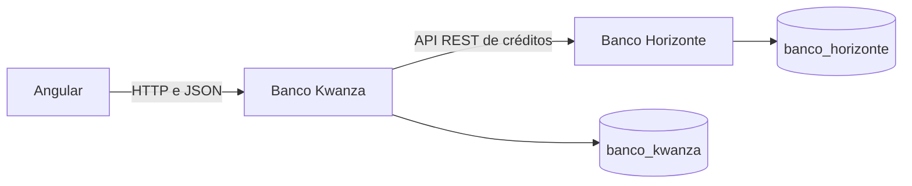

# Arquitectura inicial

Cada banco será um processo Spring Boot, com módulos internos de contas e transferências. No ambiente local, as duas bases ficam na mesma instância PostgreSQL, com utilizadores distintos. A separação permite arrancar os backends de forma independente e obriga a troca de dados dos bancos a passar pelas APIs.

## Modelo lógico

| Entidade | Banco | Dados e relações |
| --- | --- | --- |
| `users` | Ambos | Identificador, nome, email, hash da palavra-passe e perfil. |
| `accounts` | Ambos | Identificador, número de conta único, titular em `users`, saldo, saldo disponível e estado. |
| `transfers` | Kwanza | Identificador único de transferência, conta de origem local, número da conta de destino, banco de destino, montante, moeda, estado e data. |
| `received_transfers` | Horizonte | Identificador único recebido do banco de origem, conta de destino local, montante, moeda e data. A unicidade impede um segundo crédito para a mesma transferência. |
| `transactions` | Ambos | Identificador, conta local, identificador da transferência, tipo de movimento, montante e data. |

As chaves estrangeiras ligam entidades dentro da mesma base. O identificador da transferência é partilhado nos pedidos REST para correlacionar o débito e o crédito. Os montantes usam `BigDecimal` em Java e `NUMERIC` no PostgreSQL.

O Kwanza começa por registar a transferência como `PENDING` e reservar o montante. Uma confirmação de crédito permite concluir o débito e marcar a operação como `COMPLETED`. Uma recusa definitiva permite libertar a reserva e marcar a operação como `FAILED`. Se o resultado da chamada for incerto, a operação continua pendente até à reconciliação.
